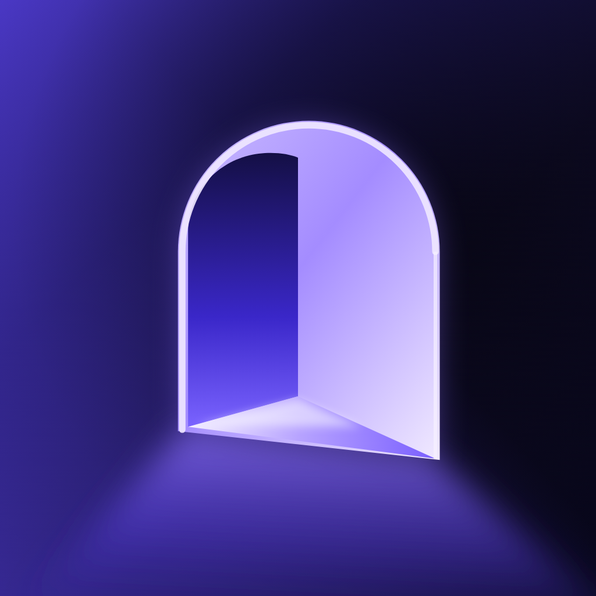

<div align="center">

# Tayfa for iPhone



### Your community's voice rooms, chat and cinema, on your phone.

[](LICENSE)
[](#build-and-run)
[](#build-and-run)

The native SwiftUI companion to the [Tayfa desktop app](https://github.com/egemenmermer/tayfa).

[What it does](#what-it-does) · [Build and run](#build-and-run) · [How it works](#how-it-works) · [Status](#status) · **[Türkçe ↓](#türkçe)**

**Self-hosted · Open source · MIT licensed**

</div>

> Tayfa used to be called ROOMS. The home-screen name is Tayfa, but targets, bundle IDs and internal type names still say ROOMS for now.

## What is this?

[Tayfa](https://github.com/egemenmermer/tayfa) is a self-hosted hangout for a small community: voice rooms, screen sharing, chat, music and shared activities. A community admin runs the backend on their own server; everyone else joins with the app.

This repository is the iPhone app. It signs in with an existing account on a Tayfa server and joins the same rooms, chats and cinema hall as the desktop app. It adds **no backend of its own** and needs no server changes: it speaks the protocols the server already runs (Stoat for accounts and chat, Tayfa Access for rooms and grants, LiveKit for real-time media).

There is no public App Store build. To use it, build it with your own Apple developer account and point it at your community's server.

## What it does

- **Voice rooms:** join, talk, mute, set each person's volume, noise reduction, and optional room camera with front/back switch. Moderator moves from desktop are followed; members with the rights can move, disconnect, kick or ban.
- **Screen shares:** watch one desktop screen share at a time, full screen and in landscape, with its audio controlled separately from voice. Share your own iPhone screen through the broadcast extension when the room allows it.
- **Chat and DMs:** community channels and direct messages with replies, edits, reactions, community emoji, inline markdown, GIF search, photos, videos and files.
- **DM calls:** voice and video calls with desktop users. There is no CallKit/PushKit yet, so a call rings only while the app is open.
- **Cinema hall:** live TV, films, series and YouTube watched together with the community, a shared queue, remote and host tools, hall chat, Picture in Picture and lock-screen controls.
- **Room activities:** whiteboard with live cursors; DJ history, shared playlists and synced lyrics.

**Desktop only for now:** Kıraathane games, soundboard, server settings and roles, cinema setup and remote control. The interface is in Turkish; an English version is in progress.

## Build and run

You need a Mac with Xcode 26 (Swift 6.1 or later), [XcodeGen](https://github.com/yonaskolb/XcodeGen), Python 3, a physical iPhone on iOS 17+, and an account on a Tayfa server. The app is tested on real devices only.

**1. Point the build at your server.** The source contains no server address. Copy the example and set your community's origin:

```sh
cp Configuration/Local.xcconfig.example Configuration/Local.xcconfig
# edit ROOMS_API_ORIGIN, e.g. https:/$()/rooms.example.com
```

`Local.xcconfig` is gitignored. Without it the app builds but refuses to sign in ("Sunucu adresi geçersiz.").

**2. Run the core tests** (macOS, no device needed):

```sh
swift test --package-path Packages/RoomsCore
```

**3. Build for your iPhone.** Set your own team and bundle IDs in `project.yml` (`DEVELOPMENT_TEAM`, `PRODUCT_BUNDLE_IDENTIFIER`, the App Group and the broadcast extension ID), then:

```sh
xcodegen generate
open ROOMS.xcodeproj   # pick your iPhone and run the ROOMS scheme
```

For an unsigned command-line device build, `./scripts/build-device.sh` writes `build/Products/Debug-iphoneos/ROOMS.app`. With `ROOMS_PROFILE`, `ROOMS_IDENTITY` and `ROOMS_DEVICE_UDID` set to your own development profile, certificate SHA-1 and device, it also signs the app. Never commit profiles or certificates.

**TestFlight.** Bump `CURRENT_PROJECT_VERSION` in `project.yml`, archive with automatic signing, then check the archive locally:

```sh
xcodegen generate
xcodebuild -project ROOMS.xcodeproj -scheme ROOMS -configuration Release -destination 'generic/platform=iOS' \
  -archivePath build/ROOMS.xcarchive -allowProvisioningUpdates archive
python3 scripts/verify-beta.py build/ROOMS.xcarchive --origin https://rooms.example.com
```

`Configuration/ExportOptions-TestFlight.plist` is the export template; change its `teamID` to yours. `xcodegen generate` rewrites `ROOMS.xcodeproj/project.pbxproj` in an older format, so commit only the entries your change really adds.

## How it works

```
Apps/ROOMS            SwiftUI app: shell, chat, voice rooms, calls, cinema, whiteboard
Apps/ROOMSBroadcast   ReplayKit broadcast extension for sharing the iPhone screen
Packages/RoomsCore    Platform-independent client: REST, gateway, media policy, models (tested on macOS)
Configuration         xcconfig and export template; your Local.xcconfig lives here
scripts               device build, development signing and archive checks
```

- **Accounts and chat** use the server's unmodified Stoat API with the `x-session-token` header; the gateway authenticates with Stoat's `Authenticate` packet after the WSS endpoint is checked against the configured origin.
- **Rooms and media:** Tayfa Access lists rooms and issues a short-lived LiveKit grant (`/v1/media/grant`). The grant stays in memory; no LiveKit API secret ever reaches the client. LiveKit Swift is pinned to **2.17.0**.
- **Cinema:** the hall service checks membership itself; relay playlists and segments carry only a short-lived ticket, so AVPlayer loads them without headers. Provider URLs and credentials never reach the phone.
- **Security:** the session token is stored in device-only Keychain; passwords are never stored. Redirects are rejected and every endpoint must stay on the configured HTTPS origin. Only the selected screen share is subscribed; video unsubscribes in the background and the camera stops.

More detail: [privacy inventory](docs/PRIVACY.md), [message send fix](docs/MESSAGE-SEND-FIX.md), [audio interruption recovery](docs/AUDIO-INTERRUPTION-RECOVERY.md).

## Status

Version 0.1.0, in internal TestFlight testing with a friends community. 246 RoomsCore tests run on macOS. Features are checked on a physical iPhone by hand; Bluetooth routes, cellular/TURN networks and long background sessions have not been covered fully. Android is not planned in this repository.

## Contributing

Issues and pull requests are welcome. Read [CONTRIBUTING.md](CONTRIBUTING.md) first; for security problems follow [SECURITY.md](SECURITY.md). Server-side changes belong in the [desktop and server repository](https://github.com/egemenmermer/tayfa).

## License

[MIT](LICENSE). Third-party components keep their own licenses; see [THIRD_PARTY_NOTICES.md](THIRD_PARTY_NOTICES.md).

---

## Türkçe

> Tayfa'nın eski adı ROOMS'tur. Ana ekrandaki ad Tayfa; target'lar, bundle ID'ler ve iç tip adları şimdilik ROOMS olarak kalıyor.

**Tayfa iPhone uygulaması**, [Tayfa masaüstü uygulamasının](https://github.com/egemenmermer/tayfa) yerel SwiftUI eşlikçisidir. Mevcut bir Tayfa sunucusundaki hesabınla giriş yapar; masaüstüyle aynı ses odalarına, sohbetlere ve sinema salonuna katılır. Kendi arka ucu yoktur, sunucuda değişiklik gerektirmez: sunucunun zaten çalıştırdığı Stoat, Tayfa Access ve LiveKit protokollerini kullanır.

App Store'da herkese açık bir sürüm yok. Kullanmak için kendi Apple geliştirici hesabınla derleyip topluluğunun sunucusuna yönlendirmen gerekir.

### Neler yapabilirsin?

- **Ses odaları:** katıl, konuş, sustur, kişi bazında ses ayarla, gürültü azaltma ve isteğe bağlı ön/arka kamera. Masaüstündeki taşıma işlemleri izlenir; yetkin varsa taşıyabilir, sesten çıkarabilir, atabilir veya yasaklayabilirsin.
- **Ekran yayınları:** aynı anda bir masaüstü yayınını tam ekran ve yatay izle; yayın sesi konuşma sesinden ayrı ayarlanır. Oda izin veriyorsa yayın uzantısıyla kendi iPhone ekranını paylaş.
- **Sohbet ve DM:** yanıt, düzenleme, tepki, topluluk emojileri, markdown, GIF arama, fotoğraf, video ve dosya.
- **DM aramaları:** masaüstüyle sesli ve görüntülü arama. CallKit/PushKit henüz yok; arama yalnızca uygulama açıkken çalar.
- **Sinema salonu:** canlı TV, film, dizi ve YouTube'u toplulukla aynı anda izle; ortak sıra, kumanda ve ev sahibi araçları, salon sohbeti, resim içinde resim ve kilit ekranı kontrolleri.
- **Oda etkinlikleri:** canlı imleçli beyaz tahta; DJ geçmişi, ortak listeler ve senkron şarkı sözleri.

**Şimdilik yalnızca masaüstünde:** Kıraathane oyunları, soundboard, sunucu ayarları ve roller, sinema kurulumu ve uzaktan kontrol. Arayüz Türkçe; İngilizce sürüm hazırlanıyor.

### Derleme

Gerekenler: Xcode 26 (Swift 6.1+), XcodeGen, Python 3, iOS 17+ bir iPhone ve bir Tayfa sunucusunda hesap. Uygulama yalnızca gerçek cihazda test edilir.

1. `cp Configuration/Local.xcconfig.example Configuration/Local.xcconfig` ile yerel ayarı oluştur ve `ROOMS_API_ORIGIN` değerini topluluğunun sunucusuna çevir. Kaynak kodda sunucu adresi yoktur; bu dosya olmadan uygulama giriş yapmaz.
2. Çekirdek testler: `swift test --package-path Packages/RoomsCore`.
3. `project.yml` içinde kendi takımını ve bundle ID'lerini yaz, `xcodegen generate` çalıştır, `ROOMS.xcodeproj`'u açıp iPhone'unda ROOMS şemasını çalıştır.

TestFlight ve imzalama ayrıntıları yukarıdaki İngilizce bölümde. Profil, sertifika veya token'ları asla commit etme.

### Durum

Sürüm 0.1.0, bir arkadaş topluluğuyla iç TestFlight testinde. RoomsCore'un 246 testi macOS'ta çalışır. Özellikler fiziksel iPhone'da elle denenir; Bluetooth, hücresel/TURN ağları ve uzun arka plan oturumları henüz tam kapsanmadı.

### Katkı ve lisans

Issue ve PR'lar açık. Önce [CONTRIBUTING.md](CONTRIBUTING.md) belgesini oku; güvenlik sorunları için [SECURITY.md](SECURITY.md). Sunucu tarafı değişiklikleri [masaüstü ve sunucu deposuna](https://github.com/egemenmermer/tayfa) aittir. Lisans: [MIT](LICENSE).
